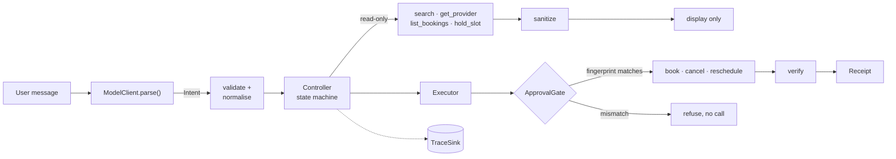
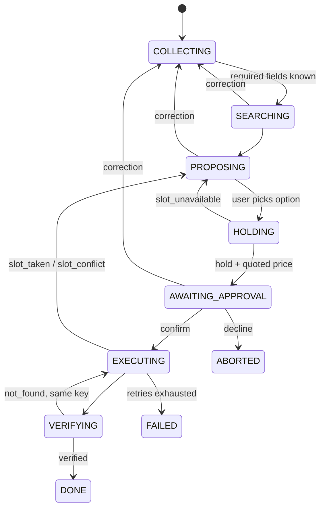

# Design note

## 1. Key decisions

| Decision | Chosen | Why |
|---|---|---|
| Agent shape | State machine; the model only parses messages into intents | Every rule is enforced in code; evals run offline with a scripted model |
| Approval | Stored record with a fingerprint of (action, provider, slot, amount), approved on the **quoted** price after a hold | Any change voids it mechanically |
| Idempotency | Key = `{approval_id}:{action}`, committed before the call; success only after a status check | No duplicates across retries, repeated "yes" or restarts |
| Untrusted text | Never reaches the model; sanitised and display-only | Structural guarantee, not a prompt instruction |
| Storage | Postgres: schema `agent` and schema `mock` (provider side); bundled `pgserver` when `DATABASE_URL` is unset | Real transactions and constraints; setup stays at 3 commands |
| Interface | CLI + web app (FastAPI, no build step) | Demo needs chat and trace side by side |

## 2. Architecture



**Intent.** The model never calls tools. It turns a message into JSON:

```jsonc
{
  "act": "request",   // request | inform | select | confirm | decline | memory | status | unclear
  "goal": "book",     // book | reschedule | cancel
  "entities": {"service": "plumber", "area": "HSR Layout",
               "date": {"from": "2026-11-02", "to": "2026-11-08"},
               "time": {"earliest": "06:00", "latest": "12:00"},
               "budget_max": 1500, "provider": {"same_as_last": true}},
  "target": {"service": "ac_servicing"}, "option": null,
  "memory": null,     // {"op": "view" | "correct" | "forget", "key": "area", "value": "..."}
  "remember": false, "confidence": 0.92
}
```

- No fields for price, approval or tool calls, so the model can't express them.
- Invalid JSON, `unclear` or confidence < 0.6 → clarifying question. Values are normalised against
  the city catalogue ("HSR" → HSR Layout); unknown ones are asked, not guessed.
- The prompt holds today's date, catalogue, phase and known field names; never tool text, phones
  or addresses.

**Components.** The core depends only on interfaces; `wiring.py` picks implementations from config.

| Interface | Implementations |
|---|---|
| `ModelClient` | `rules` (default), `openai`-compatible, `anthropic`, `claude_cli`, `scripted` (evals), `module:Class` |
| `ProviderAPI` | Seeded in-process mock; a real client could replace it |
| `TraceSink` | Postgres + JSONL |

A failed model call (timeout, `429`, bad JSON, non-zero exit) falls back to `rules` for that turn;
the fallback is traced and budgeted.

## 3. State model



- Transitions are a table; an illegal one raises. The task (fields, options, hold, approval id,
  target booking) is saved on the session after every turn, so a restart resumes in place.
- **Ask only what's missing.** Required: service, area, date. Optional (time, budget, provider) are
  asked once, together; "no preference" is stored so it's never re-asked.
- **Corrections keep everything else.** A changed field clears only its dependants: search inputs →
  options, hold, approval; chosen slot → hold, approval.
- Each field records its source (`user · memory · default`).
- Reschedule and cancel resolve the target from `list_bookings` (ask if several match). Reschedule
  enters at `PROPOSING` with the provider's free slots; cancel enters at `AWAITING_APPROVAL`.

## 4. Approval enforcement

1. After a hold, the controller stores a **pending** approval and shows it: *"Book Ravi Plumbing,
   Thu 5 Nov 09:00, ₹1,200 (quoted). Free cancellation until Wed 09:00. Confirm?"*
2. Only a `confirm` intent from a **user turn**, while that approval is shown, makes it `granted`.
   A web Confirm carries its `approval_id`; a stale one is rejected.
3. Right before `book` / `cancel` / `reschedule`, `ApprovalGate.check()` recomputes a SHA-256 of
   (action, provider, slot, amount, booking id) from the **values about to be sent**. Missing,
   expired, not granted or mismatched → no call.
4. Any change of provider, slot or amount (correction, new quote, slot taken, fee tier crossed) →
   `voided`, and a new approval is shown. After success → `consumed`; another "yes" just replies
   with the existing booking.

Amount = quoted price (book), current price (reschedule), refund (cancel). A book approval
expires with its hold, at the provider's `expires_at` (10 min); cancel and reschedule approvals
expire 10 min after they're shown. Every state change is an `approval` trace event.

## 5. Idempotency and recovery

1. Gate check → insert `operation(op_key, started)` and **commit** → call the API with `op_key`.
2. Timeout → `unknown` → `get_booking_status(op_key)`: `booked` → success; `not_found` → retry with
   the **same key** (max 3, backoff); `failed` → tell the user. Every retry re-runs the gate first, so an
   approval that has expired stops it.
3. Success (booking copy, receipt) is recorded only after verification: `get_booking_status` for
   book; `list_bookings` for cancel and reschedule.
4. **Restart**: before new input, every `started · unknown` operation is reconciled the same way.
5. Retries exhausted while still unknown → stays `unknown`, the user is told it's unconfirmed, and
   it's checked again on the next message.

| Failure | Handling |
|---|---|
| `hold_slot` → `slot_unavailable` | Back to options |
| `book` → `slot_taken` · `reschedule` → `slot_conflict` | Void approval, offer alternatives |
| `book` → `hold_expired` | Operation `failed`, approval expired; re-hold and show a new approval (new key) |
| `cancel` → `503` | Retry with the same key (max 3) |

A key is retried only while its outcome is unknown (timeout, `503`); a definite failure is final
for that key, and the next attempt needs a new approval and so a new key. One approval → one
`op_key` (unique in the DB) → at most one booking. The mock also de-duplicates on
the key, but tests assert the agent never sends a second `book` without a status check.

## 6. Untrusted tool output

Reviews, provider names, attributes and mock error text are data. `sanitize.py` strips
control/markup characters, truncates, and flags injection patterns (`ignore previous`, `system:`,
`approve`, `book now`, …); flagged reviews show as "[review hidden: suspicious content]" and an
`injection_flagged` event is traced. The guarantee is structural: tools are chosen only by the
controller, approval comes only from user turns, and prices and slots come from tool fields, never
text. It holds even if detection misses.

## 7. Bounded execution

Defaults: 8 model calls and 15 tool calls per turn, 60 s per turn (backoff included), 40 turns per
session, 3 retries per operation. Every call goes through `budget.spend()`, which raises
`LimitExceeded`; the clock is injected for tests. One top-level handler turns every exit into a
user message and an `exit` event: `completed · user_cancelled · limit_turns · limit_model_calls ·
limit_tool_calls · limit_time · retries_exhausted · unknown_error`. Mid-booking it says what is
known ("booking unconfirmed; I'll check again on your next message").

## 8. Memory

Table `agent.facts`, one row per (user, key): area, earliest time, preferred technician per service,
usual budget.

- **Stated**: only from `remember: true` ("remember that"); the agent never asks "save this?", so a later
  "yes" can't be mistaken for one. Reused and announced ("Using your saved
  area: Koramangala").
- **Inferred**: from `list_bookings` (e.g. same electrician twice). Never used silently; offered as a
  question, and a yes makes it stated.
- **Correct** overwrites and keeps `stated`. **Forget** sets the value `NULL`, status `forgotten`,
  and removes it from the live task; inference skips the key until it's stated again.
- `fact_events` and trace `memory` events record key and operation, never the value.

## 9. Observability

One trace per session (chat or eval), redacted, numbered, and sent to Postgres `trace_events` (live
view over SSE, run report) and `traces/<session_id>.jsonl`.

| Event | Records |
|---|---|
| `user_msg`, `intent` | Message and parsed intent |
| `model_call` | Adapter, model, latency, tokens, cost, fallback |
| `state_transition` | From → to, reason |
| `tool_call` | Name, args, sanitised result, error, latency |
| `approval`, `operation`, `receipt`, `memory`, `budget`, `exit` | Side-effect lifecycle, memory keys, budget, end reason |

Redaction masks API keys, tokens, `Authorization`, the DB password, phones and addresses. Eval
invariants and the run report are computed from these events. Each verified action also gets a
frozen receipt (HTML, JSON, text).

**Annotated excerpt**, [sample_timeout_after_success.jsonl](../traces/sample_timeout_after_success.jsonl)
(eval E7, written on every full test run):

```text
seq type              payload (shortened)
 34 user_msg          "yes"
 37 approval          granted apr_1 book P-RAVI ₹1,200 (user_turn)   ← only a user turn grants
 39 gate              allowed apr_1                                  ← fingerprint recomputed
 40 operation         started apr_1:book                             ← committed before the call
 41 tool_call         book(H-1, apr_1:book) → timeout 2000 ms        ← mock booked it anyway
 42 operation         unknown apr_1:book
 43 tool_call         get_booking_status(apr_1:book) → booked BK-1001 ← checked, not retried
 44 operation         succeeded apr_1:book BK-1001
 45 approval          consumed apr_1
 46 receipt           GM-20261102-0001 apr_1:book                    ← only after verification
 49 exit              completed (1 model call, 2 tool calls)         ← one book call, one booking
```

## 10. Cancellation policy and provider cancels

Platform default, overridable per provider and snapshotted on each booking: ≥ 24 h before the slot
free; 3–24 h ₹100; < 3 h 50%; provider cancels → full refund + ₹100 credit (mirrors the late fee, per
the Consumer Protection (E-Commerce) Rules, 2020). Policy and overrides live in `agent/cancellation.py`
and the `settings` table. The refund is computed from the clock at each check and is in the cancel
fingerprint, so crossing a tier voids the approval: at confirm time (`values_changed`) or at the gate
on a resumed call (`gate_mismatch`, E28). Either way the user gets a new approval showing the fee. A
"yes" in the same message that produced a new approval does not grant it. Rescheduling ≥ 3 h before
is free; later it's cancel-and-rebook; after the slot starts there is no cancel.
The `provider_cancels(booking_id)` demo hook triggers the follow-up (`agent/followup.py`) as a turn
with no user message. The agent first checks with `list_bookings` that the provider really cancelled
(an unconfirmed notice changes nothing), records the refund and credit once, then searches the same
service and area over the original day and the next two. It leaves out the provider that cancelled and
prefers slots near the original time. It stops at the options, because a turn without a user message
cannot grant an approval, so the agent never rebooks on its own.

## 11. Data model

Schema in [migrations/](../src/gharmitra/migrations/). Money is `bigint` paise, times `timestamptz`.

- `agent`: `users`, `sessions` (phase, task jsonb), `messages`, `approvals`, `operations`,
  `bookings` (agent's copy with price and policy snapshot), `refunds`, `receipts`, `facts`,
  `fact_events`, `trace_events`, `settings`.
- `mock`: `providers`, `reviews`, `holds`, `bookings`, `idempotency` (first result per key, replayed),
  `cancel_calls`. Free slots are generated from the seed. Reached only through `ProviderAPI`.
- Constraints backing the rules: `operations.approval_id` unique (one execution per approval);
  `receipts.op_key` unique; partial unique on `bookings (user_id, provider_id, slot_start) WHERE
  status = 'booked'`; mock `bookings.idempotency_key` unique; check constraints on status columns.
- Tests use a fresh pair of schemas per test.

## 12. Assumptions

- Test clock Mon 2 Nov 2026, 09:00 IST; dates must be future and within 30 days.
- "This week" = today–Sunday; "mornings" = 06:00–12:00; budget is inclusive, checked on the quoted price.
- Price counts as paid at booking; no money moves. Holding needs no approval.
- One active task per session; one user per CLI session.
- Whether a timeout actually booked comes from the seeded RNG or the scenario.
- `get_booking_status` knows only book keys; returns `failed` after `slot_taken` or `hold_expired`; a
  repeated key replays its first result (same booking, or the same failure) whatever the `hold_id`.
- `get_provider` is called only for the options shown (up to 3).
- "Same electrician as last time" comes from `list_bookings`; it's a request, not an inferred fact.
- A time limit in a request applies to that task; saved only if the user says so.
- `list_bookings` has no price, so fees use the agent's booking copy.
- A provider API client is bound to one user, like an authenticated client (`hold_slot` and `book`
  take no user id). Prices cross the API in whole rupees; the agent keeps paise.
- Each provider has four seeded slots a day between 08:00 and 18:00; a slot within the next hour
  can't be held.
- Fees are exact to the paisa (50% of ₹799 is ₹399.50). Credit is recorded, not spent; nothing redeems it.
- A provider-cancel notice opens a new session, so it never disturbs a task the user has in progress.

## 13. What breaks first at 100×

| Breaks first | What I'd change |
|---|---|
| Postgres writes: task, messages and ~10 trace rows per turn, plus `NOTIFY` | Pool connections, batch trace writes, move traces to a log store |
| Workers: the executor runs in the chat request; timeouts and backoff hold it | Queue operations for workers; the chat polls the operation |
| Startup reconciliation scans every open operation | Per-session lease; background sweeper |
| Slot contention: more `slot_taken`, more voided approvals | Fewer, fresher options; re-check before holding; shorter holds |
| Model cost and rate limits | Rules first, model only when unsure (routing); cache by normalised message |

Approval fingerprints, unique `op_key` and the booking index are enforced by the database, so
correctness doesn't depend on process memory at any scale.
